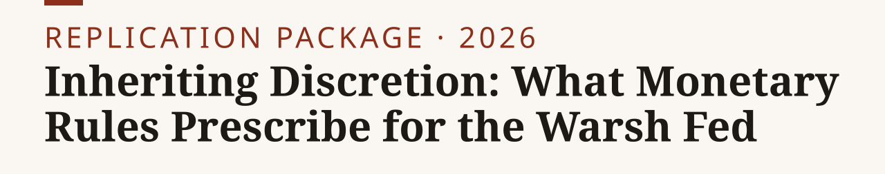
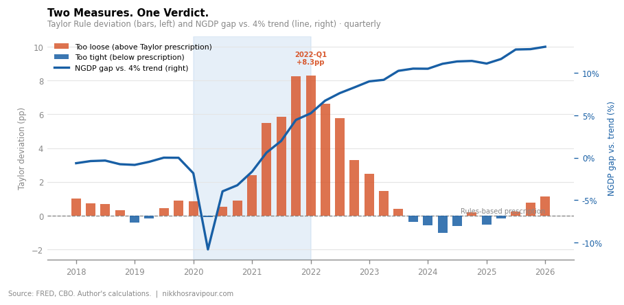

<p><picture><source media="(prefers-color-scheme: dark)" srcset="assets/banner-dark.svg"></picture></p>

**Four monetary rules applied to the Warsh Fed's inheritance do not agree on what it should do: nominal GDP runs 13% above its pre-pandemic path, and the Taylor-rule gap peaked at +8.3 pp in 2022 Q1.**

[Paper](https://nikkhosravipour.com/post/inheriting-discretion-what-monetary-rules-prescribe-for-the-warsh-fed) · [Data](#data-availability) · [Site](https://nikkhosravipour.com)

[](LICENSE) [](LICENSE-docs) [](https://www.r-project.org/)

<picture><source media="(prefers-color-scheme: dark)" srcset="output/figures/fig0_hook-dark.png"></picture>

> [!NOTE]
> Runtime: a few minutes, mostly FRED requests. Built with R 4.3 and Python 3.12. Data vintage: published figures use the FRED state at publication; see [Data vintage](#data-vintage).

R pulls quarterly macroeconomic series from FRED and scores the actual federal funds rate against four monetary-rule benchmarks. Python reads the scored data and generates Chart.js widgets and static figures. The pipeline mirrors the [Taylor-rule deep dive repo](https://github.com/nik110403/taylor-rule) so the two projects read as one research program.

## Quick start

1. Clone: `git clone https://github.com/nik110403/warsh-fed.git && cd warsh-fed`
2. Get a free [FRED API key](https://fredaccount.stlouisfed.org/apikeys), then `cp .Renviron.example .Renviron` and set `FRED_API_KEY` in it.
3. Run the R pipeline from the repo root: `Rscript run_all.R`. Packages (`fredr`, `dplyr`, `zoo`, `lubridate`) install on first run via `R/setup.R`. The script prints a key-numbers block (latest quarter rates, peak deviations).
4. Install the Python packages (no lock file; any recent versions work): `python -m venv .venv && . .venv/bin/activate && pip install numpy pandas matplotlib`
5. Build the charts: `python python/charts.py` and `python python/dotplot.py`. Figures land in `output/figures/` and Chart.js widgets in `output/widgets/`.

R loads `.Renviron` from the project root automatically. Run all commands from the repo root; `run_all.R` errors if called from a subdirectory.

## Exhibit map

Every figure in the paper, the script that makes it and the file it writes. Widgets are the interactive Chart.js versions of the same charts.

| Exhibit | Script | Output |
|---|---|---|
| Headline: Taylor gap and NGDP gap | `python/charts.py` | `output/figures/fig0_hook.png`, `output/widgets/fig0_hook.html` |
| Policy rate vs. Taylor rules | `python/charts.py` | `output/figures/fig1_taylor_vs_actual.png`, `output/widgets/fig1_taylor_vs_actual.html` |
| NGDP level vs. 4% path | `python/charts.py` | `output/figures/fig2_ngdp_level.png`, `output/widgets/fig2_ngdp_level.html` |
| FOMC median dots vs. realized rate | `python/dotplot.py` | `output/figures/fig0_dotgap.png`, `output/widgets/fig0_dotgap.html` |

`python/charts.py` reads `output/data/rules_export.csv`, which `Rscript run_all.R` writes. `python/dotplot.py` needs no pipeline output: the two FOMC median projections and the realized quarterly rate (FRED `FEDFUNDS`) are hard-coded in the script.

## Data availability

| Dataset | Source | Access | Included |
|---|---|---|---|
| FEDFUNDS, PCEPILFE, GDPC1, GDPPOT, GDP, M2SL | [FRED](https://fred.stlouisfed.org/) (BEA, BLS, CBO, Federal Reserve Board) | Public, free API key | Scored output only: `output/data/rules_export.csv`. Raw pulls (`data-raw/`) and `.rds` intermediates are not committed. |
| FOMC median federal funds rate projections (Dec 2015, Mar 2021) | [federalreserve.gov](https://www.federalreserve.gov/monetarypolicy/fomccalendars.htm) | Public | Hard-coded in `python/dotplot.py`, together with the realized rate |

Source data is served by FRED and subject to its terms. The code licence does not cover it.

## Data vintage

FRED revises historical series, including `GDPPOT` (CBO potential output) and `GDP`
(nominal, subject to benchmark revision). Results reproduce exactly against the vintage
retrieved for the published piece; subsequent pulls may shift rule prescriptions. The sample
window is locked at 2018 Q1–2026 Q1 in `R/config.R` (`START_DATE`, `END_DATE`).

`R/config.R` also pins a `FRED_VINTAGE` (realtime-as-of date) passed as
`realtime_start`/`realtime_end` on every FRED pull, with the raw response archived under
`data-raw/fred/<FRED_VINTAGE>/`. The published figures predate this pin — they reflect
whatever FRED reported at publication time, not `FRED_VINTAGE`. Re-running `R/01_data.R`
reproduces the FRED state as of `FRED_VINTAGE`, which will diverge from the published
numbers as FRED revises `GDPPOT`, `GDP`, and other series.

## FRED series

| Series ID | Description | Transformation |
|---|---|---|
| `FEDFUNDS` | Effective federal funds rate | levels |
| `PCEPILFE` | Core PCE deflator | YoY% (`pc1`) |
| `GDPC1` | Real GDP | levels |
| `GDPPOT` | CBO potential real GDP | levels |
| `GDP` | Nominal GDP | levels |
| `M2SL` | M2 money stock | levels |

Monthly series convert to quarterly by taking the last observation of each quarter.

## Rule specifications

| Rule | Formula | Key parameters |
|---|---|---|
| Taylor (baseline) | r\* + π + 0.5(π − π\*) + 0.5·y_gap | r\* = 0.5%, π\* = 2% |
| Taylor (original) | same | r\* = 2.0% (Taylor 1993) |
| Meltzer k-percent | M2 YoY growth vs. fixed target | k = 4% |
| Selgin productivity norm | NGDP growth vs. potential GDP growth | NGDP trend = 4%/yr from 2019 Q4 |

Taylor rules are floored at zero. Output gap = 100·(GDPC1 − GDPPOT)/GDPPOT. The NGDP
level path compounds at 1% per quarter from the 2019 Q4 base (`NGDP_BASE_DATE` in
`R/config.R`).

## Where things can drift

`GDPPOT` is revised with each CBO Budget and Economic Outlook, shifting the Taylor
output-gap term. `GDP` benchmark revisions alter both the Meltzer M2 deviation and the
NGDP gap. The Meltzer and Selgin rules are more stable to revision than the Taylor
variants. The companion piece documents the vintage used.

## Repository layout

```text
warsh-fed/
├── run_all.R          # runs the R pipeline in order
├── R/
│   ├── setup.R        # package management
│   ├── config.R       # sample window, vintage, pi*, r*, k-percent, NGDP trend
│   ├── 01_data.R      # FRED pull -> quarterly series -> output/data/df_raw.rds
│   ├── 02_rules.R     # rule scoring -> df_rules.rds
│   └── 03_export.R    # CSV export + key numbers -> output/data/rules_export.csv
├── python/
│   ├── charts.py      # widgets and PNG figures from rules_export.csv
│   └── dotplot.py     # FOMC dots vs. realized rate
├── output/
│   ├── data/          # rules_export.csv
│   ├── figures/       # static PNGs
│   └── widgets/       # Chart.js HTML embeds
├── assets/            # banner and social preview (made by tools/banner)
├── .Renviron.example  # template for the FRED API key
├── CITATION.cff
├── LICENSE            # MIT (code)
└── LICENSE-docs       # CC BY 4.0 (text and figures)
```

## Citation

GitHub shows a "Cite this repository" button from `CITATION.cff`. BibTeX:

<details>
<summary>BibTeX</summary>

```bibtex
@misc{warsh_fed2026,
  author = {Khosravipour, Nik},
  title  = {Inheriting Discretion: What Monetary Rules Prescribe for the Warsh Fed},
  year   = {2026},
  url    = {https://github.com/nik110403/warsh-fed}
}
```

</details>

## License

Code: [MIT](LICENSE). Text and figures: [CC BY 4.0](LICENSE-docs). Source data is public, served by [FRED](https://fred.stlouisfed.org/) and subject to its terms; neither licence covers it.
